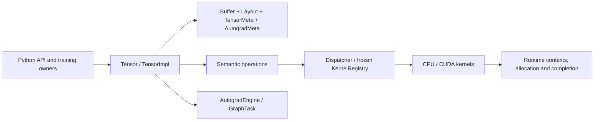

# Orthon


A compact C++17/CUDA tensor and autograd runtime with a PyTorch-style Python API.
Orthon **1.0.0rc1** is a prerelease intended for developer evaluation.
It is not a stable or production-qualified release.
See the [release notes](RELEASE_NOTES.md), [changelog](CHANGELOG.md) and
[support and limitations](SUPPORT.md) before selecting a build.

Compared with 0.1.0, RC1 redesigns tensor ownership, operator dispatch, graph
execution and state restore while preserving existing core capabilities.
The [change overview](RELEASE_NOTES.md#what-changed-since-v010) explains the scope.

Orthon provides CPU tensors, an optional CUDA backend, first-order reverse-mode
autograd, neural-network modules, SGD/Adam, explicit mixed precision, local
multiprocessing collectives and optional single-node NCCL. PyTorch is used as a
numerical reference where applicable; Orthon has its own supported API and semantics.



## Build and install

Declared requirements are Python >=3.10, NumPy >=1.21.3,
scikit-build-core >=0.11 and pybind11 >=3.0, plus a C++17 compiler and CMake.
Actual minimum-version compatibility remains unverified. The strongest audited
environment is Linux x86_64 with Python 3.13.15 and NumPy 2.5.3.
From the source directory, select a CPU build explicitly:

```bash
python -m pip install . -C cmake.define.WITH_CUDA=OFF -C cmake.define.WITH_NCCL=OFF
```

The CPU distribution artifacts are a `cp313-cp313-linux_x86_64` wheel and an sdist.
Install a local wheel with `python -m pip install /path/to/orthon-1.0.0rc1-cp313-cp313-linux_x86_64.whl`.
This wheel is specific to the built Linux platform; it is not a portable manylinux
distribution. PyPI publication and stable 1.0.0 support are outside this RC1 scope.

For CUDA, install a compatible NVIDIA toolkit and driver, then build:

```bash
python -m pip install . -C cmake.define.WITH_CUDA=ON -C cmake.define.WITH_NCCL=OFF
python -c "import orthon; print(orthon.cuda_enabled(), orthon.nccl_enabled())"
```

These flags report compilation features; a real allocation/transfer checks usable
hardware. CMake presets `cpu-release`, `avx2-release`, `cuda-release` and
`cuda-nccl-release` support native development. The NCCL preset additionally needs
NCCL headers and a library. See [testing](docs/testing.md) for package selection.

## CPU quick start

This complete synthetic training example needs no dataset or PyTorch:

```python
import orthon as o

model = o.nn.Sequential(o.nn.Linear(4, 8), o.nn.ReLU(), o.nn.Linear(8, 2))
optimizer = o.optim.SGD(model.parameters(), lr=0.01)
x = o.full([3, 4], 0.2)
for _ in range(3):
    optimizer.zero_grad()
    output = model(x)
    loss = o.mean(output * output)
    loss.backward()
    optimizer.step()
print(loss.item())
```

Views share a Buffer while retaining independent tensor metadata. Gradients
accumulate across backward calls until cleared. A graph is released by default;
use `backward(retain_graph=True)` when reusing it. Higher-order autograd is unsupported.

## Explicit mixed precision (CUDA only)

There is no autocast. Cast the model and inputs explicitly; the wrapper optimizes
FP32 master weights and copies updated values back to the stable model owners:

```python
import orthon as o

model = o.nn.Linear(4, 2).to("cuda:0").half()
optimizer = o.amp.MixedPrecisionOptimizer(model, o.optim.Adam, lr=0.001)
scaler = o.amp.GradScaler(init_scale=128.0)
x = o.full([3, 4], 0.2).to("cuda:0").cast("float16")
optimizer.zero_grad()
output = model(x)
loss = o.mean(output * output)
scaler.scale(loss).backward()
scaler.step(optimizer)
scaler.update()
o.cuda_synchronize()
print(loss.to("cpu").cast("float32").item())
```

BF16 can use a disabled scaler. See [training](docs/training_stack.md) for
owner identity, state loading and AMP-DDP integration.

## Checkpointing

The single-file, pickle-free `ml-runtime-checkpoint` version 1 archive snapshots
model state, optimizer state and optional metadata. This independent CPU example
uses a temporary directory:

```python
import tempfile
from pathlib import Path
import orthon as o

model = o.nn.Linear(4, 2)
optimizer = o.optim.Adam(model.parameters())
with tempfile.TemporaryDirectory() as directory:
    path = Path(directory) / "model.ckpt"
    o.save_checkpoint(path, model=model, optimizer=optimizer, metadata={"step": 0})
    metadata = o.load_checkpoint(path, model=model, optimizer=optimizer)
    print(metadata["step"])
```

Whole-file validation and prepared recipient state precede commit.
See [checkpoint format](docs/checkpoint_format.md). Checkpoints are local files;
there is no sharded distributed checkpoint service.

## Distributed and CUDA boundaries

[Distributed](docs/distributed.md) explains the public facade, captured ProcessGroup,
Reducer and Work ownership. The local backend transfers payloads through host
multiprocessing state. Optional NCCL implements GPU-resident collectives on a
single node. It requires a CUDA+NCCL build and suitable hardware; multi-node
rendezvous is unsupported.

Physical NCCL and multi-GPU behavior on the current audited source remain
unvalidated. Local multiprocessing tests do not establish those capabilities.

CUDA operator/dtype coverage is partial: see the [coverage matrix](docs/cuda_coverage.md).
Partial CUDA `__setitem__` and strided CUDA in-place destinations are unsupported.
Streams are internal runtime services; there is no public Python stream API.
`cuda_synchronize()` is the public compatibility synchronization operation.

Inherited full CUDA testing retains 98 actual unsupported-case failures
(76 cast combinations and 22 fill cases). Python shutdown LeakSanitizer
attribution remains `OPEN_UNRESOLVED_BOUNDED`, including process exit 23.
Historical small-operation CUDA admission overhead was approximately 10
microseconds on the measured hardware/workloads. See [support](SUPPORT.md)
for qualification scope and unresolved limitations.

## Tests and measurements

CPU CI is automated. Hardware tests use real feature/device gates; build flags
alone do not establish GPU coverage. See the five-layer [test architecture](docs/testing.md).

```bash
python -m pip install '.[test]' -C cmake.define.WITH_CUDA=OFF -C cmake.define.WITH_NCCL=OFF
ORTHON_TEST_PROFILE=cpu python -m pytest -q -m architecture
ORTHON_TEST_PROFILE=cpu python -m pytest -q
cmake --preset cpp-cpu-release
cmake --build --preset cpp-cpu-release
ctest --preset cpp-cpu-release
```

Orthon includes a correctness-first benchmark harness with warmup, adaptive
batching, multiple samples, median/IQR and recorded provenance. Performance is
not a contract. From the repository with PyTorch installed for comparison:

```bash
python -m benchmarks.compare_pytorch --device cpu --quick --benchmark elementwise_add --json /tmp/comparison.json
```

Read [benchmarking](docs/benchmarking.md) and [profiling](docs/nsight_profiling.md)
for measurement and attribution workflows.

## Project layout and documentation

| Directory | Responsibility |
| --- | --- |
| `include/orthon/` | Canonical native headers and public/native compatibility |
| `src/` | Core, runtime, autograd, semantic ops, backends, distributed and diagnostics |
| `bindings/` | Thin pybind bridges |
| `python/orthon/` | Python training owners, public facades and private services |
| `tests/` | Five-layer test architecture |
| `examples/` | Runnable applications and training demos |
| `benchmarks/` | Measurement, profiling and reporting package |
| `docs/` | Current API, architecture and development guides |

Start with the [documentation index](docs/README.md), [API reference](docs/api.md)
and [architecture](docs/architecture.md). Source and executable tests define
behavior; the guides explain current contracts and workflows.

## Repository

Read [contributing](CONTRIBUTING.md) for development and review expectations, and the
[MIT license](LICENSE) for the current license. The [documentation index](docs/README.md)
connects the current guides.
