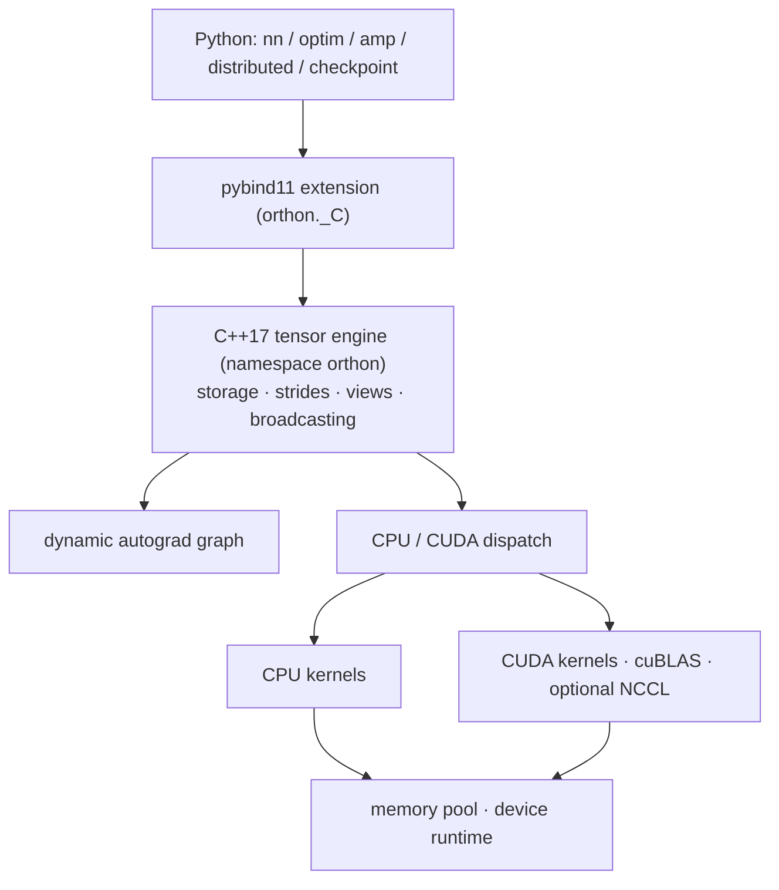

<p align="center">
  
</p>

<div align="center">

# Orthon

### A compact C++17/CUDA tensor and autograd runtime with a PyTorch-style Python API.

</div>

Orthon is a deep learning runtime built from the storage layer up: a native
C++17 tensor engine with strides and storage-sharing views, a dynamic autograd
graph, handwritten CPU and CUDA kernels, pybind11 bindings, an `nn.Module`
training stack with optimizers and mixed precision, a pickle-free checkpoint
format, and single-node distributed fundamentals.

It is a systems project. The point is that every layer — from `x * y` in
Python down to the size-class allocator behind it — is legible, explained, and
pinned by tests, with PyTorch used throughout the suite as the numerical
reference. It is not a production replacement for PyTorch and does not claim
to be.

## Why it is interesting

A few of the design decisions worth reading for, each covered in depth in
[`docs/`](#documentation):

- **Selective saved-tensor version checking.** Autograd nodes watch the
  storage-level mutation generation of exactly the tensors their backward
  formula *reads* — so mutating an operand of `x * y` before `backward()`
  fails loudly with the node and role named, while mutating the operand of
  `x * 3` stays legal, because d(x·3)/dx never reads `x`. Wrong-gradient bugs
  become errors; harmless mutation stays allowed.
  ([docs/autograd.md](docs/autograd.md))
- **Backward that structurally cannot corrupt itself.** Node backward formulas
  are written in public differentiable ops, so the whole traversal runs under
  one RAII no-grad guard — gradients cannot come back carrying a second graph,
  by construction rather than by per-node convention.
- **Real views with correct gradients.** `transpose`, `slice` and indexing
  share storage via strides and offsets; their gradients route back through
  the view transformation in logical coordinates.
- **Contiguous-only CUDA kernels, normalized once.** No kernel is taught about
  strides. Public ops linearize strided operands at one auditable boundary,
  while the autograd node stays attached to the *original* tensor — graph
  shape, mutation watches and view routing all describe the caller's program.
  ([docs/cuda_runtime.md](docs/cuda_runtime.md))
- **Exact-device CUDA discipline.** Every allocation, copy and launch is
  guarded to its operand's own device (RAII `DeviceGuard`), never the ambient
  CUDA context; cross-GPU copies name both ordinals via `cudaMemcpyPeer`. The
  single-GPU/multi-GPU validation boundary is stated honestly.
- **Rank-0 scalar arithmetic.** `x * 2` builds an O(1) rank-0 constant on the
  tensor's exact device and dtype — no data-shaped temporary, and no spurious
  mutation watch.
- **A checkpoint format that cannot execute code.** ZIP + JSON manifest + raw
  tensor bytes, SHA-256 per tensor, deterministic archives, atomic saves,
  validate-everything-before-mutating loads; every dtype round-trips
  bit-for-bit, NaN payloads included.
  ([docs/checkpoint_format.md](docs/checkpoint_format.md))

## Core capabilities

- **Tensors** — shape, strides, dtype, device, storage offset and contiguity,
  with storage-sharing views (`reshape`, `transpose`, `slice`, integer index).
  Nine dtypes: `float32`, `float64`, `float16`, `bfloat16`, `int32`, `int64`,
  `uint8`, `int8`, `bool`.
- **Autograd** — dynamic graph, reverse topological traversal, gradient
  accumulation, retained graphs, broadcast-gradient reduction, differentiable
  `.to()`/`cast()`, and stale-mutation detection.
- **CPU and CUDA** — one public API over both. Handwritten CUDA kernels for
  matmul (2-D and batched 3-D), Conv2d, MaxPool2d, unary/binary ops,
  reductions, max/argmax, softmax, cross entropy, NLL loss, embedding and
  dropout, plus a caching memory pool with a reusable scratch workspace.
  cuBLAS Tensor Core GEMM backs FP16/BF16 matmul where shape and device fit.
- **Training stack** — `Linear`, `Conv2d`, `MaxPool2d`, `Dropout`,
  `LayerNorm`, `Embedding`, BatchNorm, attention modules and a Transformer
  encoder block; SGD and Adam; one seeded framework RNG behind `manual_seed`.
- **Mixed precision** — FP32 master weights (`MixedPrecisionOptimizer`) and a
  dynamic `GradScaler` with finite checks, skipped steps, backoff and growth;
  under DDP, ranks synchronize non-finite-gradient decisions.
- **Checkpointing** — one versioned format (`ml-runtime-checkpoint` v1) for
  model state, optimizer state and metadata; no pickle anywhere.
- **Distributed fundamentals** — a local multiprocessing backend and a
  single-node NCCL backend, DDP gradient hooks, buckets and async work
  handles.

## Architecture



A call travels down and back: Python reaches a bound op, the op dispatches on
its operands' device and dtype, an autograd node is attached when an input
requires grad, `backward()` walks the graph in reverse topological order, and
the optimizer applies the update — optionally through AMP FP32 master weights.
[`docs/architecture.md`](docs/architecture.md) walks the full stack.

## Quick start

```bash
pip install -e .        # CUDA auto-detected; absent means CPU-only
```

```python
import orthon as ortho
from orthon.nn import Linear, ReLU, Sequential
from orthon.optim import SGD

model = Sequential(Linear(4, 16), ReLU(), Linear(16, 2))

x = ortho.ones([8, 4])
target = ortho.ones([8, 2])
opt = SGD(model.parameters(), lr=0.01)

for _ in range(10):
    opt.zero_grad()
    error = model(x) - target
    loss = ortho.mean(error * error)
    loss.backward()
    opt.step()

print(loss.item())
```

## Autograd in a few lines

```python
import orthon as ortho

x = ortho.ones([2, 3]).requires_grad_(True)
y = x * x + 3.0                      # scalar: rank-0 constant, no temporary
z = ortho.sum(y.transpose(0, 1))     # storage-sharing view mid-graph
z.backward()
print(x.grad.tolist())               # [2.0, 2.0, 2.0, 2.0, 2.0, 2.0]
```

And the mutation safety that distinguishes the engine:

```python
a = ortho.ones([3]).requires_grad_(True)
b = a * a                  # MulNode records a's storage version
a.add_(a, alpha=1.0)       # in-place mutation bumps it
ortho.sum(b).backward()    # raises: "tensor saved by MulNode as 'lhs' was
                           #          modified in-place after it was saved"
```

The check is selective — `b = a * 3.0` followed by the same mutation and
backward succeeds, because that derivative never reads `a`. Details in
[`docs/autograd.md`](docs/autograd.md).

## Mixed-precision training on CUDA

```python
import orthon as ortho
from orthon.amp import GradScaler, MixedPrecisionOptimizer
from orthon.nn import Linear, ReLU, Sequential
from orthon.optim import Adam

model = Sequential(
    Linear(512, 1024),
    ReLU(),
    Linear(1024, 10),
).to("cuda").half()

opt = MixedPrecisionOptimizer(model, Adam, lr=1e-3)
scaler = GradScaler(init_scale=128.0)

x = ortho.ones([256, 512]).to("cuda").cast("float16")

opt.zero_grad()
out = model(x)
loss = ortho.sum(out * out)
scaler.scale(loss).backward()
scaler.step(opt)
scaler.update()
```

## Checkpointing

```python
ortho.save_checkpoint(
    "run.ckpt", model=model, optimizer=opt, metadata={"step": 100},
)
metadata = ortho.load_checkpoint(
    "run.ckpt", model=model, optimizer=opt, map_location="cuda",
)
```

Loading validates the whole archive — manifest, byte counts, SHA-256 per
tensor — before touching the destination, so a malformed file cannot leave a
model half-updated, and nothing in the file can execute code.

## Building

**CPU:**

```bash
pip install -e .                 # CUDA auto-detected; absent means CPU-only
pip install -e ".[test]"         # adds pytest and PyTorch for the test suite
pytest -q
```

PyTorch is a numerical **reference** for the parity tests, not a runtime
dependency; without it the suite still runs and the comparison tests skip.

**CUDA** (`WITH_CUDA=AUTO` by default; force or forbid it):

```bash
SKBUILD_CMAKE_DEFINE="WITH_CUDA=ON" pip install -e .
SKBUILD_CMAKE_DEFINE="WITH_CUDA=OFF;WITH_NCCL=OFF" pip install -e .
```

**Plain CMake** (native library, tests, extension):

```bash
cmake --preset cpu-release && cmake --build --preset cpu-release
cmake --preset cuda-release            # CUDA kernels, no NCCL
cmake --preset cuda-nccl-release       # CUDA + NCCL collectives
```

`orthon.cuda_enabled()` reports what was compiled in, so a CPU-only build says
so rather than failing at the first kernel launch.

## Testing and validation

```bash
python -m pytest -q                      # Python suite

cmake --preset cpp-cpu-release           # native C++ suite
cmake --build --preset cpp-cpu-release
ctest --preset cpp-cpu-release
```

Multi-GPU validation, run on a Linux machine with two NVIDIA
A100-SXM4-80GB GPUs (CUDA 12.8, GCC 13.3, NCCL 2.27.3):

| Suite | Result |
| --- | --- |
| Python, CUDA+NCCL build (2x A100) | 3426 passed, 20 skipped, 0 failed |
| Native C++, Linux/GCC CUDA (2x A100) | 186 discovered, 186 passed, 0 skipped |

Those two rows are a record of that run and are not restated for the current
tree, which has since gained six autograd regression tests.

The remaining 20 Python skips are hardware/configuration gates — most need
four or eight GPUs, which that machine does not have. The three native
`DeviceGuard` tests that need a second GPU, which skip on single-GPU
machines, executed there and passed. That run covers the tree as it stood
immediately before one later, device-agnostic autograd correction; the exact
boundary is in [docs/ddp_cloud_validation.md](docs/ddp_cloud_validation.md).

Current tree, on the single-GPU development machine:

| Suite | Result |
| --- | --- |
| Python, CPU build | 2186 passed, 889 skipped |
| Python, CUDA build (RTX 4070 Laptop, 1 GPU) | 3397 passed, 60 skipped |
| Native C++, Windows/MSVC CPU | 182 / 182 |
| Native C++, Windows/MSVC CUDA (1 GPU) | 191 discovered, 188 passed, 3 skipped |
| Native C++, Linux/GCC CPU | 182 / 182 |

Zero failures in every configuration; every case a machine cannot honestly
run skips explicitly rather than pretending. CI covers CPU only,
deliberately: GitHub-hosted runners have no GPU, and a CUDA job on one would
report green while proving nothing. [`docs/testing.md`](docs/testing.md) has
the full picture.

## Selected Orthon vs. PyTorch results

Orthon is not intended as a replacement for PyTorch. It was built to understand
and implement the systems underneath modern ML frameworks. But once the kernels
exist, the honest question is how they measure up — so they were measured
against PyTorch eager on the same GPU, with inputs pre-placed on the device,
alternating sample rounds, and numerical equivalence proved before every timing.

On the RTX 4070 Laptop GPU used for Orthon's benchmarks, two specialized paths
outperform PyTorch eager reliably enough to quote. Each is an Orthon win in all
four independent runs, is never flagged noisy, and matches PyTorch's output to
within `1e-07` relative (the forward value matches exactly).

**Cross entropy, forward — 2048 × 4096**

```text
Orthon      0.175 ms
PyTorch     0.536 ms
Speedup     3.06x        (2.45x - 3.06x across 4 runs)
```

**Cross entropy, forward + backward — 4096 × 4096**

```text
Orthon      3.143 ms
PyTorch     4.523 ms
Speedup     1.44x        (1.36x - 1.44x across 4 runs)
```

One fused kernel reads the logits once instead of materializing a full
log-softmax and gathering. The advantage is bounded and the boundary is
published: it depends on a large class count, and reverses at `8192 × 512`,
where PyTorch is 4.1x faster.

PyTorch wins 16 of the 36 cases, Orthon 9, with the rest ties or too close to
call — FP32 matmul goes to PyTorch by up to 6.4x and Conv2d by up to 11.8x.
A third result, Fused Linear + ReLU, was previously quoted here at 1.68x; it
was measured against an eager composition slower than PyTorch's own
`F.linear`, and against the correct baseline that shape is a PyTorch win, so
the claim has been withdrawn rather than replaced. The complete benchmark
matrix, the methodology, the numerical-equivalence checks and every losing case
are published in
[`profiles/PYTORCH_COMPARISON.md`](profiles/PYTORCH_COMPARISON.md).

```bash
python benchmarks/compare_pytorch.py                    # the whole matrix
python benchmarks/compare_pytorch.py --highlight cross_entropy --shape 2048 4096
```

## Project layout

```text
include/orthon/        Public C++ headers (namespace orthon)
src/                   Tensor engine, autograd, CPU/CUDA kernels, memory/device code
bindings/              pybind11 extension (orthon._C)
python/orthon/         Python package: nn, optim, amp, distributed, checkpointing
tests/python/          pytest correctness, reference and architecture tests
tests/cpp/             C++ unit tests (GoogleTest, run via CTest)
tests/smoke/           Packaging smoke test for an installed wheel
examples/              Training workloads and profiling drivers
benchmarks/            Focused benchmark scripts and the PyTorch comparison harness
docs/                  Architecture, format, coverage and workload documentation
profiles/              Profiling notes and benchmark results
.github/workflows/     CPU continuous integration
```

## Scope and known limitations

- **Multi-GPU validation covers two GPUs.** Orthon was validated on real
  2x A100 hardware — exact `cuda:N` placement, cross-GPU transfer and
  autograd, NCCL collectives, and multi-step DDP in every synchronization mode
  all ran there. That run predates one later autograd correction, which is
  device-agnostic and left every device path byte-identical. The `>=4`/`8`-GPU
  test gates were not rerun; an earlier project state has a recorded 2/4/8-GPU
  cloud run ([details](docs/ddp_cloud_validation.md)). On single-GPU machines
  every `>=2`-device test still skips explicitly.
- **CUDA in-place ops require contiguous destinations**, and **partial CUDA
  `__setitem__` is unsupported** — both raise rather than silently degrading.
- **CUDA kernels are contiguous-only by design**; views are normalized at the
  public op, never inside kernels.
- **`softmax` is float32-only**; CUDA compute covers
  float32/float16/bfloat16, with float64 compute on CPU.
- **Checkpoints are single-file and local** — not sharded or distributed.
- **Benchmark numbers are narrow, hardware-specific microbenchmarks**, taken
  on one RTX 4070 Laptop GPU against PyTorch eager. Orthon loses more of the
  matrix than it wins; every losing case is published in
  [PYTORCH_COMPARISON.md](profiles/PYTORCH_COMPARISON.md). No performance
  timing anywhere in this repository comes from the 2x A100 machine, which
  produced multi-GPU correctness evidence only.

The full lists live with the layer that owns each limit:
[cuda_runtime.md](docs/cuda_runtime.md#limitations),
[training_stack.md](docs/training_stack.md#boundaries),
[ddp_cloud_validation.md](docs/ddp_cloud_validation.md).

## Documentation

| Document | What it covers |
| --- | --- |
| [`docs/architecture.md`](docs/architecture.md) | The complete stack, Python API to allocator |
| [`docs/autograd.md`](docs/autograd.md) | Graph construction, backward, views, mutation safety |
| [`docs/cuda_runtime.md`](docs/cuda_runtime.md) | Device model, kernels, dtypes, validation boundary |
| [`docs/training_stack.md`](docs/training_stack.md) | `nn.Module`, optimizers, AMP, RNG |
| [`docs/checkpoint_format.md`](docs/checkpoint_format.md) | The on-disk format and its safety properties |
| [`docs/testing.md`](docs/testing.md) | Test layers, per-configuration counts, CI, CUDA limits |
| [`docs/cuda_coverage.md`](docs/cuda_coverage.md) | Per-operation CPU/CUDA/autograd support matrix |
| [`docs/training_workloads.md`](docs/training_workloads.md) | Example workloads and how to run them |
| [`docs/ddp_cloud_validation.md`](docs/ddp_cloud_validation.md) | Distributed: supported vs validated |
| [`docs/nsight_profiling.md`](docs/nsight_profiling.md) | CUDA profiling workflow |
| [`profiles/PYTORCH_COMPARISON.md`](profiles/PYTORCH_COMPARISON.md) | Orthon vs. PyTorch eager: full matrix, methodology, losses |
| [`profiles/RESULTS.md`](profiles/RESULTS.md) | Recorded benchmark results |
