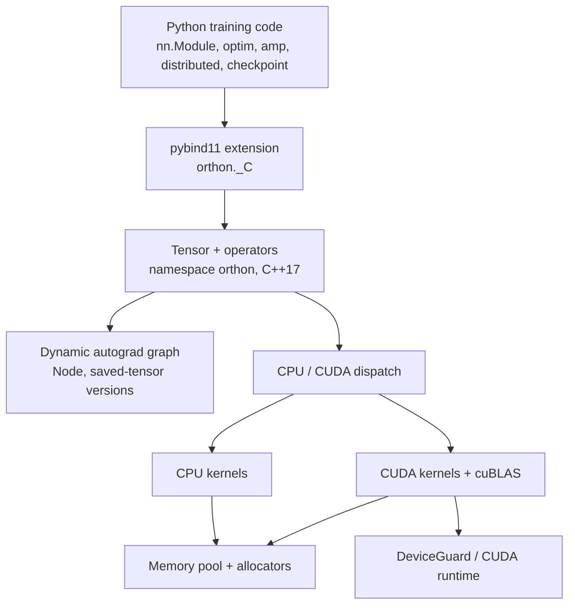

# Architecture

How Orthon is put together, from the Python API down to the allocator. This is
the entry point for reading the runtime; the deeper documents —
[autograd](autograd.md), [CUDA runtime](cuda_runtime.md),
[training stack](training_stack.md), [checkpoint format](checkpoint_format.md),
[testing](testing.md) — each expand one layer described here.

## System overview



The split between Python and C++ is deliberate and stable:

- **Native (C++17/CUDA)** — tensor representation, every operator kernel, the
  autograd graph and backward engine, device management, memory pooling, and
  the raw byte codec used by checkpointing. This is the part where performance
  and aliasing semantics live, so it is the part written once, in one place.
- **Python** — everything that is policy rather than mechanism: `nn.Module`
  and layers, optimizers, AMP, the distributed wrappers, and the checkpoint
  container format. These compose public tensor operations, so they inherit
  device support and autograd behaviour instead of re-implementing them.

A training step travels the whole stack: Python calls a bound op, the op
dispatches on its operands' device and dtype, an autograd `Node` is attached
when an input requires grad, `backward()` walks the graph in reverse
topological order, and the optimizer applies the update inside a `no_grad`
region.

## Tensor representation

Three classes share the work that "a tensor" usually hides:

```text
Tensor            value-semantic handle; the public API surface
  └─ TensorImpl   shape, strides, storage offset, autograd metadata
       └─ Storage owned bytes + dtype + device + mutation version counter
```

- **`Tensor`** (`include/orthon/core/tensor.h`) is a thin handle around a
  `shared_ptr<TensorImpl>`. Copying a `Tensor` copies a pointer, so tensors
  pass by value everywhere, including into autograd nodes.
- **`TensorImpl`** (`include/orthon/core/tensor_impl.h`) holds the *logical*
  description — `shape`, `strides`, `storage_offset`, plus the autograd fields
  (`requires_grad`, `is_leaf`, `grad`, `grad_fn`, post-accumulate hooks). Two
  `TensorImpl`s may describe different windows onto the same bytes.
- **`Storage`** (`include/orthon/core/storage.h`) owns the allocation: a raw
  pointer, byte count, dtype, and `Device`. It also carries the atomic
  **version counter** that autograd's saved-tensor validation reads — the
  counter lives here, not on `TensorImpl`, precisely so that mutating a tensor
  through *any* view advances the one generation every alias observes.

### Views versus copies

`transpose`, `slice`, integer indexing (`t[i]`) and (where the layout permits)
`reshape` build a new `TensorImpl` that *shares* the existing `Storage` with
adjusted shape, strides and offset. No bytes move. This is what makes
`x.transpose(0, 1)` O(1) and what makes writes through a view visible through
every other alias of the same storage.

The cost of views is that element order in memory no longer matches logical
order. `is_contiguous()` answers whether it still does, and
`contiguous()` materializes a logical-order physical copy when it does not —
as a differentiable public op whose backward is an identity pass-through, so a
view can be linearized mid-graph without disturbing gradient routing.

Dtypes are plumbed through the whole representation: nine are supported
(`float32`, `float64`, `float16`, `bfloat16`, `int32`, `int64`, `uint8`,
`int8`, `bool`) for allocation, fill, `from_numpy`, transfer, `item()`/
`tolist()` and contiguity materialization. Compute coverage per dtype is
narrower and is tabulated in [cuda_coverage.md](cuda_coverage.md).

## Operation dispatch

Follow `z = x * y`:

1. Python's `x * y` invokes the bound `mul` in `orthon._C`.
2. The public `mul` (`src/ops/cpu/binary_ops.cpp`) validates that both operands
   share a device and dtype, then branches on the device.
3. **CPU:** a stride-aware broadcast loop applies the op directly; strided
   views need no special handling.
4. **CUDA:** raw kernels are deliberately contiguous-only. The public op
   normalizes each operand through `kernel_operand()`
   (`src/ops/cpu/shape_ops.cpp`): identity for a contiguous tensor, otherwise
   one same-device physical linearization made under an explicit
   `NoGradGuard`. The kernel then launches under a `DeviceGuard` for the
   operands' exact device.
5. If grad mode is on and an input requires grad, a `MulNode` is attached **to
   the original tensors the caller passed** — not to the materialized kernel
   operands — so the graph, saved-version watches and view gradient routing
   all describe the caller's program.

Two consequences of this design are worth naming:

- **Kernels stay simple.** No CUDA kernel is taught about strides; layout
  normalization happens once, at the public boundary, identically for every
  op. The trade-off is an extra copy for strided CUDA operands, accepted in
  exchange for one auditable contract instead of per-kernel stride code.
- **The public surface stays uniform.** An op accepts the same non-contiguous
  inputs on CUDA that it accepts on CPU, and the device never changes what an
  operation means. `tests/python/test_runtime_consistency.py` pins this.

Subtraction and division are compositions (`sub(a,b) = add(a, neg(b))`,
`div(a,b) = mul(a, reciprocal(b))`), so they inherit validation, broadcasting
and autograd from the ops they are built on. Python scalars on either side of
an operator (`x * 2`, `4 / x`) become rank-0 constants that take the tensor's
dtype and exact device — O(1) storage that broadcasts, rather than a
data-shaped temporary.

## Autograd

Autograd is dynamic: the graph is whatever the forward pass actually executed,
rebuilt every iteration. Each differentiable op attaches a `Node` holding its
input tensors; `backward()` collects the reachable graph with a depth-first
post-order walk, validates every node's saved-tensor versions *before running
anything*, then traverses in reverse topological order, accumulating gradients
into leaves.

Three properties distinguish the implementation:

- **The whole traversal runs under `NoGradGuard`**, structurally — node
  backward formulas are written in terms of public differentiable ops, and
  this one guard is what keeps them from attaching a second graph to the
  gradients they produce.
- **Saved-tensor version checking is selective.** A node watches only tensors
  whose *values* its backward formula reads. `x * y` watches both operands;
  `x * 3` watches nothing, because d(x·3)/dx = 3 reads no payload. A watched
  tensor mutated in-place between forward and backward fails the backward with
  a precise diagnostic instead of silently producing a wrong derivative.
- **View gradients flow in logical coordinates.** `IndexNode`, `SliceNode`,
  `TransposeNode` and `ReshapeNode` route gradients back through the view
  transformation, so a program built on storage-sharing views differentiates
  correctly.

[autograd.md](autograd.md) covers all of this in depth.

## Device model

A `Device` is a `(type, index)` pair — `cpu` or `cuda:N` — parsed from and
formatted to the usual strings. Mixed-device operations raise; movement is
explicit through `Tensor.to`.

CUDA's runtime keeps a *current device* per thread, and any allocation, copy or
launch that does not pin it inherits whatever happened to be current — a
correctness hazard on any machine with more than one GPU. Orthon's rule is
that **the authoritative device is always the operand's own**, enforced by the
RAII `DeviceGuard` (`include/orthon/device/device_guard.h`): construct it from
the tensor's `Device` at every dispatch point, and the guard makes that device
current for the scope and restores the caller's device on exit, exceptions
included. Constructing a guard for a CPU device is a no-op, so guards sit
unconditionally at dispatch points serving both devices.

Allocation follows the same rule: `Storage` sends CUDA requests straight to the
memory pool with the tensor's actual device, so a `cuda:N` tensor cannot be
silently allocated on `cuda:0`. Cross-GPU transfer uses `cudaMemcpyPeer`, which
names both device ordinals explicitly rather than trusting ambient context.
Details, including the exact validation boundary — local single-GPU coverage
versus the final 2-GPU release validation — are in
[cuda_runtime.md](cuda_runtime.md).

## Memory

All tensor storage — CPU and CUDA — allocates through one caching memory pool
(`src/core/memory_pool.cpp`):

- Requests round up to **64-byte size-class bins**; freed blocks go to a
  per-device, per-size free list and are reused for later requests of the same
  class, replacing `malloc`/`cudaMalloc` churn with a list pop in steady-state
  training loops.
- The cache has a configurable byte limit with eviction, plus counters
  (allocation/reuse/current/peak/cached bytes) exposed through
  `orthon._memory_pool_stats()` and friends for benchmarks and tests.
- A separate per-device **scratch workspace** — a reusable bump-pointer
  buffer — serves short-lived temporaries such as the partial buffers of full
  CUDA reductions, without cycling them through the free lists.

Deliberately absent: block splitting/coalescing and stream-aware CUDA
allocation. The pool is a size-class cache, not a CUDA-caching-allocator
re-implementation.

CPU blocks are 64-byte aligned; CUDA blocks are allocated under a
`DeviceGuard` for the exact requested device.

## Python bindings

The extension module `orthon._C` is plain pybind11 (`bindings/`): tensor and
dtype/device classes, every public operator, grad-mode controls, memory-pool
introspection, and the NCCL collectives in CUDA+NCCL builds. There is no code
generation and no dispatcher DSL — each binding is an ordinary `m.def`, which
keeps the Python↔C++ boundary readable in one sitting.

`python/orthon/__init__.py` re-exports the native surface and adds the pure
Python layers on top. Two build-time facts are queryable at runtime:
`orthon.cuda_enabled()` and `orthon.nccl_enabled()` report what was compiled
in, so a CPU-only build says so instead of failing at the first kernel launch.

## Training stack

`nn.Module`, the layers, `optim.SGD`/`optim.Adam`, and the AMP components are
Python code over public tensor ops. Parameter registration, buffers,
`state_dict`, device movement and dtype casts are implemented once in
`Module`; optimizers step inside `no_grad`; AMP keeps FP32 master weights
beside a low-precision model and scales losses dynamically. See
[training_stack.md](training_stack.md).

`orthon.distributed` adds a correctness-first single-node DDP layer — local
multiprocessing and NCCL backends, parameter broadcast, gradient
synchronization hooks, optional bucketing — documented with its exact
supported-versus-validated boundary in
[ddp_cloud_validation.md](ddp_cloud_validation.md).

## Checkpointing

`save_state_dict` / `load_state_dict` / `save_checkpoint` / `load_checkpoint`
share one codec (`python/orthon/checkpoint.py`) writing the
`ml-runtime-checkpoint` v1 container: a ZIP holding a JSON manifest plus raw
little-endian tensor bytes. Loading parses data and copies bytes — there is no
pickle, so a checkpoint cannot execute code — and validates the entire archive
(manifest, byte counts, per-tensor SHA-256) before mutating anything. Saves
are atomic and deterministic. The format and its safety argument are specified
in [checkpoint_format.md](checkpoint_format.md).

## Design boundaries

Orthon deliberately does not implement:

- **A JIT, graph compiler or operator fusion framework.** One fused op
  (`fused_linear_relu`) exists as a systems demonstration; everything else is
  eager.
- **Stride-aware CUDA kernels.** Views are normalized at the public op, never
  inside kernels; in-place CUDA ops therefore require contiguous destinations.
- **Higher-order autograd.** `backward(create_graph=...)` does not exist; the
  backward pass itself never records.
- **A general RNG service.** One seeded framework stream drives
  initialization; there are no per-device generator objects.
- **Multi-node distributed training,** sharded checkpoints, elastic launch or
  fault tolerance.
- **PyTorch replacement ambitions.** PyTorch appears in the test suite as the
  numerical reference the implementation is checked against.

The complete honest list of current limitations is kept with the layer that
owns each one: [cuda_runtime.md](cuda_runtime.md#limitations),
[ddp_cloud_validation.md](ddp_cloud_validation.md),
[testing.md](testing.md#cuda-and-multi-gpu-boundary).
