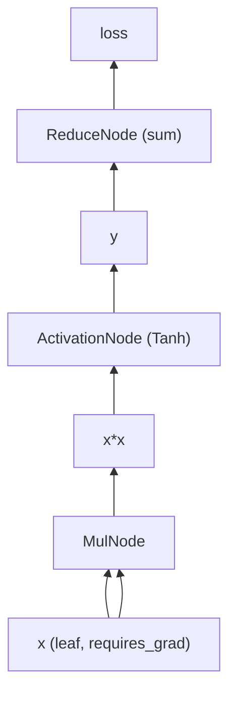

# Autograd

How Orthon computes gradients: how the graph comes into existence during the
forward pass, how `backward()` traverses it, and how the runtime defends the
correctness of saved values against in-place mutation. Architectural context
is in [architecture.md](architecture.md); per-operation backward coverage is
tabulated in [cuda_coverage.md](cuda_coverage.md).

The engine lives in `src/core/tensor.cpp` (`Tensor::backward`),
`include/orthon/autograd/node.h` / `src/autograd/node.cpp` (the `Node` base
and version validation), and one small header per operation under
`include/orthon/autograd/`.

## The graph

Orthon's autograd is **dynamic**: there is no graph object to define ahead of
time. Running the forward pass *is* defining the graph, and each iteration
builds a fresh one, so Python control flow — loops, conditionals, data-
dependent shapes — needs no special treatment.

Three pieces of per-tensor metadata carry the graph:

- **`requires_grad`** — whether gradients should flow to (or through) this
  tensor. Off by default; enabled with `t.requires_grad_(True)`, and set
  automatically on every parameter by `nn.Parameter`.
- **`grad_fn`** — the `Node` that produced this tensor, if an operation
  produced it while grad mode was on. Tensors with a `grad_fn` are *interior*
  to the graph.
- **`is_leaf`** — true for tensors the user created directly. Only leaves
  receive a `.grad` accumulation at the end of backward; interior gradients
  are transient values of the traversal.

A `Node` is small:

```cpp
class Node {
public:
    std::vector<Tensor> inputs;                       // the graph edges
    virtual std::vector<Tensor> backward(const Tensor& grad_output) = 0;
    void watch_version(const Tensor& t, std::string role);   // see below
    ...
};
```

`inputs` holds the operation's input tensors by value (cheap: a `Tensor` is a
`shared_ptr` handle). Since each input tensor in turn carries its own
`grad_fn`, the nodes form the whole graph implicitly — there is no separate
edge structure and no global registry, and dropping the output tensor drops
the graph with it.

### Construction during forward

Every differentiable op ends with the same pattern, here from `mul`:

```cpp
if (is_grad_enabled() && (a.requires_grad() || b.requires_grad())) {
    out.requires_grad_(true);
    out.set_is_leaf(false);
    out.set_grad_fn(std::make_shared<MulNode>(a, b));
}
```

So for

```python
import orthon as ortho

x = ortho.ones([3]).requires_grad_(True)
y = ortho.tanh(x * x)
loss = ortho.sum(y)
```

the graph is:



## The backward pass

`loss.backward()` does five things, in a fixed order chosen so that failures
happen before any state changes:

1. **Collect** the reachable graph with a depth-first post-order walk from the
   output; reversing that order yields a valid output-first topological order.
2. **Preflight-validate** every node's saved-tensor versions (next section) —
   before the seed gradient is built, before any node runs, before any `.grad`
   or hook fires. A stale in-place mutation therefore fails the *whole* call
   cleanly, with no partially written gradients left behind.
3. **Seed** the output's gradient with ones of the output's shape, dtype and
   device.
4. **Traverse** in reverse topological order. Each node receives its output's
   accumulated gradient, re-validates its saved versions (a hook running
   mid-traversal could mutate storage after the preflight), and returns one
   gradient per input. When several graph paths reach the same tensor — `y`
   used twice — the incoming gradients are summed, which is the multivariable
   chain rule falling out of the data structure.
5. **Write leaves.** Each leaf that requires grad gets the accumulated
   gradient added into `.grad` (accumulating across `backward()` calls, which
   is what gradient accumulation over micro-batches relies on), then its
   post-accumulate hooks run — the mechanism DDP uses to trigger gradient
   synchronization.

Unless `backward(retain_graph=True)` was requested, the traversal then clears
`grad_fn` on every interior tensor, freeing the graph. Calling `backward()` a
second time on a freed graph raises rather than recomputing garbage.

### Backward itself records nothing

The entire traversal runs under a `NoGradGuard`. This is load-bearing, not a
performance nicety: node backward formulas are written in terms of *public
differentiable ops applied to the very tensors the node holds* — `MulNode`
computes `mul(grad, inputs[1])`, and `inputs[1]` typically requires grad.
Without the guard, those calls would attach fresh nodes, and `x.grad` would
come back carrying `requires_grad=True` and a live `grad_fn`.

The guard is structural — one RAII object in `Tensor::backward` — rather than
a convention each node must remember. Grad mode governs graph *construction*
only, never whether an existing graph may execute, so the guard does not
change what backward computes. It is also the single line that would need to
become conditional if higher-order autograd (`create_graph`) were ever added;
today it is not, and that is a stated design boundary.

## Broadcasting and unbroadcast

Forward broadcasting (`[2,3] + [3]`) means an input's gradient can arrive
shaped like the *output*. Every binary node funnels its result through
`unbroadcast(grad, input_shape)` (`src/autograd/grad_utils.cpp`), which sums
the gradient over every broadcast dimension — the adjoint of replication is
summation — and reshapes to the input's shape. The reduction is typed on the
gradient's dtype (float32/float64 on CPU) and is stride-aware, so a strided
gradient view coming out of an upstream node reduces correctly.

## Views, indexing and slicing

`t[i]`, `t.slice(dim, start, end)`, `transpose` and `reshape` are
storage-sharing views, and their nodes translate gradients between the view's
coordinates and the parent's:

- **`IndexNode` / `SliceNode`** scatter the gradient into a zero tensor shaped
  like the parent — everything outside the selected region has derivative
  exactly zero. Negative indices/dims are normalized once, in the forward; the
  node stores resolved values and never re-interprets the caller's spelling.
- **`TransposeNode`** returns the gradient transposed back — itself a view, no
  copy.
- **`ReshapeNode`** reshapes the gradient to the input's original shape.
- **`ContiguousNode`** (from `contiguous()`) is an identity pass-through: the
  materialization changed layout, not values, so the gradient flows to the
  upstream node unchanged and *that* node handles any coordinate
  transformation.

Because a node may legitimately hand back a strided gradient (TransposeNode
returns a view), consumers normalize: the engine's gradient accumulation and
each elementwise backward kernel wrap incoming gradients in `contiguous()`,
a no-op when already contiguous.

## Saved tensors and mutation safety

A backward formula generally needs values from forward time. `MulNode` needs
both operands; `ActivationNode` for `tanh` needs the input to evaluate
`1 - tanh²(x)`. Nodes hold those tensors in `inputs` (or privately, like
`MaxNode`'s argmax buffer) — but holding a tensor does not freeze it. The user
can mutate it in place after the forward:

```python
y = x * w
x.add_(x, alpha=1.0)       # in-place; y's backward would now read wrong values
ortho.sum(y).backward()    # must not silently miscompute dL/dw
```

Orthon's defense is a **version counter on `Storage`** — the level where the
bytes live, so mutation through *any* view of the same storage advances the
one counter every alias observes. Every successful in-place mutation bumps it;
metadata changes (view construction, `requires_grad`) do not.

At construction, a node calls `watch_version(t, role)` for each tensor whose
values its backward reads, recording the storage and its current version.
Validation compares recorded to current — at the preflight and again
immediately before each node runs — and a mismatch raises:

```text
backward: tensor saved by MulNode as 'lhs' was modified in-place after it
was saved for backward (expected version 2, found 3)
```

### Selective watching

The design principle is that **a node watches exactly the values its backward
formula reads — no more**. Which is not the same as "everything it touched in
forward":

| Operation | Watches | Why |
| --- | --- | --- |
| `x * y` | both operands | each side's gradient multiplies by the *other* side's forward values |
| `x + y` | nothing | d(x+y)/dx = 1; no payload is read |
| `tanh(x)`, `sqrt(x)`, … | the input | f′(x) is evaluated from forward-time values |
| `neg(x)` | nothing | backward is `-grad`; the input payload is never read |
| `x * 3` (Python scalar) | nothing | d(x·3)/dx = 3, a constant copied into the node |
| `t.slice(...)`, `t[i]`, `transpose`, `reshape` | nothing | pure coordinate transforms |
| `x.to(device)`, `cast(x, dtype)` | nothing | derivative is identity in logical coordinates |
| `embedding(indices, weight)` | the indices | backward scatters into the positions the indices name |

The scalar row is why scalar arithmetic gets its own nodes
(`include/orthon/autograd/scalar_node.h`) instead of reusing the tensor-tensor
ones. Routing `x * 3` through `MulNode` would watch `x` — turning the legal
program "scale, then mutate `x`, then backward" into a spurious error, since
dy/dx = 3 does not depend on `x` at all — and would also compute and then
discard an O(numel) gradient for the constant. Value-*insensitive* operations
staying unwatched is what keeps in-place mutation legal wherever it is
mathematically harmless, while value-*sensitive* operations still fail loudly
when their saved values go stale.

Scalar composition preserves the right watch sets automatically: `x - s`
becomes `ScalarAdd(x, -s)` (no watch), while `s / x` becomes
`ScalarMul(reciprocal(x), s)` — and the `reciprocal` node watches `x`, exactly
as d(s/x)/dx = −s/x² requires.

## Grad mode

`orthon.no_grad()` (Python context manager) and `set_grad_enabled` /
`is_grad_enabled` control a thread-local flag read at every node-attachment
site. Inside `no_grad`, forward computation proceeds normally but produces
plain tensors with no `grad_fn` — the idiom for evaluation:

```python
model.eval()
with ortho.no_grad():
    logits = model(x)
```

Nested contexts restore the previous state on exit. Parameters keep
`requires_grad=True` throughout; only *outputs created inside* the context are
detached from any graph. Internal machinery uses the same mechanism: optimizer
steps, `Module.to`/`cast`, checkpoint snapshots and kernel-operand
materializations all run under explicit no-grad regions, so none of them leak
nodes into the user's graph.

## Differentiable `.to()` and `cast()`

Device movement and floating→floating dtype conversion are graph operations,
not graph breaks:

- **`ToNode`** — forward is a physical copy whose values equal the input in
  logical order; the derivative is identity, so backward simply moves the
  gradient back to the source device. This is what lets a loss computed on
  CUDA backpropagate into a CPU-resident leaf.
- **`CastNode`** — attached only for genuine floating→floating conversions;
  backward casts the gradient back to the source dtype. Conversions involving
  integer or bool dtypes never join a graph (there is no straight-through
  estimator), and a same-dtype `cast` is a contiguity normalization, never a
  `CastNode`.

Both are value-insensitive (no version watch), which AMP depends on: the FP32
master-weight machinery casts freely between precisions without either
breaking the graph or acquiring spurious mutation watches.

## What is deliberately not here

- **Higher-order gradients** — no `create_graph`; the backward pass never
  records.
- **Forward-mode AD.**
- **A tape or global engine object** — graph lifetime is tensor lifetime.
- **Tie-splitting in `max` backward** — the gradient goes to the first
  argmax position, not shared across ties.
- **`neg` as a standalone-differentiable op is covered via `ActivationNode`;**
  see [cuda_coverage.md](cuda_coverage.md) for the per-op backward matrix.

The behavioural contract is pinned by the Python suites
(`tests/python/test_autograd_*.py`, `test_backward_*.py`,
`test_inplace_versioning.py`, `test_grad_composition.py`,
`test_scalar_arithmetic.py`) with PyTorch as numerical reference, and by the
native C++ tests where the engine's C++ contracts are asserted without Python
in the picture.
